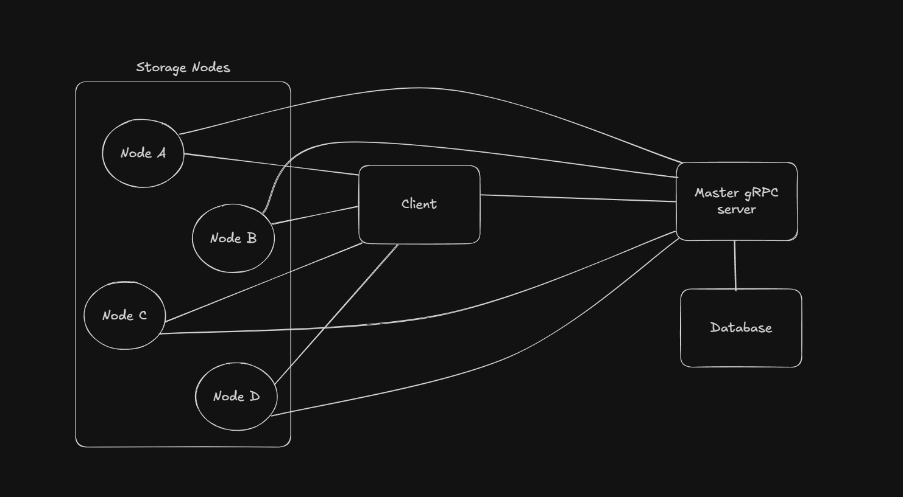

# Bibous

Sistema distribuído de armazenamento de arquivos. Sua arquitetura é composta por três componentes independentes: cliente, mestre e nós de armazenamento.

O objetivo do sistema é permitir o armazenamento e a recuperação de arquivos distribuídos entre diferentes nós, com replicação, verificação de integridade e recuperação automática diante de falhas.

## Arquitetura

Adota uma arquitetura de coordenação centralizada com armazenamento distribuído. O mestre gerencia os metadados e determina a localização das réplicas; os nós armazenam os dados; o cliente solicita operações e transfere os arquivos diretamente para os nós indicados pelo mestre.



### Mestre

O mestre é o coordenador central do sistema. Suas principais responsabilidades são:
 
* Receber o registro de novos nós e acompanhar sua disponibilidade por meio de heartbeats.
* Manter metadados dos arquivos e diretórios, incluindo tamanho, hash e localização das réplicas.
* Selecionar os nós de destino de novos arquivos, considerando capacidade disponível e fator de replicação.
* Coordenar operações solicitadas pelo cliente, como envio, consulta, listagem, remoção e movimentação de arquivos.
* Detectar nós indisponíveis e solicitar a criação de novas réplicas quando necessário.
* Persistir os metadados para possibilitar a recuperação do estado após uma reinicialização.

O mestre não atua como intermediário do conteúdo dos arquivos: sua função é coordenar as operações, evitando que o tráfego de dados se concentre em um único processo.

## Nó

O nó é o componente que disponibiliza espaço em disco para armazenar arquivos ou blocos de arquivos. O mesmo programa pode ser executado em várias instâncias, cada uma com identidade, endereço e diretório de dados próprios.

Entre suas responsabilidades estão:

* Enviar heartbeats periódicos ao mestre.
* Receber, armazenar e disponibilizar dados para leitura por clientes autorizados.
* Verificar a integridade dos dados por hash.
* Transferir réplicas diretamente para outros nós quando solicitado pelo mestre.
* Informar alterações de capacidade e reconciliar os dados locais após reinicializações.

## Cliente

O cliente é a interface de linha de comando (CLI) utilizada para interagir com o sistema.

Para operações de arquivos, o cliente consulta inicialmente o mestre, que informa os nós responsáveis pelos dados. Com essas informações, o cliente realiza upload e download diretamente nos nós de armazenamento, sem encaminhar o conteúdo pelo mestre.

A interface prevista inclui operações de envio, download, remoção, renomeação, movimentação, criação e listagem de diretórios, além de consulta de metadados e do estado de replicação.

## Como rodar (master + storages + cliente)

Requisito: Go instalado. O script sobe 1 mestre e 5 storages na própria máquina; cada storage tem um `MACHINE_ID` diferente para simular máquinas distintas (o mestre nunca coloca duas réplicas na mesma máquina) e se apresenta como um disco de 10 GiB (`CAPACITY`).

```bash
bash scripts/local-cluster.sh start        # compila e sobe mestre (porta 50051) e storages (8081-8085)
bin/client status                          # nós vivos/suspeitos/mortos, espaço e arquivos por estado
```

Ao subir, cada storage se registra sozinho no mestre (`MASTER_ADDR`) e manda heartbeat a cada 3 s com o espaço livre. Um nó sem heartbeat vira suspeito após 9 s e morto após 15 s; então o mestre recria as réplicas que faltam em outros nós.

### Comandos do cliente

```bash
bin/client mkdir -p /docs/2026
bin/client put ./relatorio.pdf /docs/2026/relatorio.pdf   # -f para sobrescrever
bin/client ls /docs/2026
bin/client stat /docs/2026/relatorio.pdf                  # tamanho, hash, estado e réplicas de cada bloco
bin/client get /docs/2026/relatorio.pdf ./copia.pdf
bin/client mv /docs/2026/relatorio.pdf /docs/final.pdf
bin/client rm /docs/final.pdf
bin/client rmdir -r /docs
bin/client drain storage-5                                # esvazia um nó antes de desligá-lo
bin/client -key 0123456789abcdef0123456789abcdef put ./x /x   # criptografia AES-256-GCM no cliente
```

O endereço do mestre é `localhost:50051` por padrão (`-master` ou `BIBOUS_MASTER`); a chave também pode vir de `BIBOUS_KEY`. Outras flags: `-replicas`, `-block-size`, `-parallel`, `-timeout`, `-retries`, `-q`.

### Demonstração de falhas

```bash
bash scripts/local-cluster.sh kill storage-1     # derruba um nó (kill -9)
bin/client get /docs/2026/relatorio.pdf ./c.pdf  # continua funcionando, lê de outra réplica
sleep 20; bin/client status                      # storage-1 morto; arquivos voltam a íntegros
bash scripts/local-cluster.sh revive storage-1   # o nó volta e se registra de novo
bash scripts/local-cluster.sh stop               # derruba tudo (clean apaga também dados e logs)
```

Para simular corrupção, sobrescreva um arquivo `.blk` em `cluster/data/storage-N/`: no próximo `get` o cliente detecta o hash errado, lê de outra réplica e reporta ao mestre, que recria a cópia. Logs em `cluster/logs/`.

### Como o cliente funciona

O cliente fala com o mestre pelo `MasterService` (`proto/master.proto`) e com os nós pelo `StorageService` (`proto/storage.proto`):

1. divide o arquivo em blocos de até 4 MiB (cifrando cada bloco com AES-256-GCM se houver `-key`) e calcula o SHA-256 de cada bloco e do conteúdo inteiro;
2. `PrepareUpload`: o mestre escolhe os nós de cada bloco (espaço livre, máquinas e discos distintos);
3. envia cada bloco direto a todas as réplicas com `PutBlock`, em paralelo — os dados não passam pelo mestre;
4. `CommitUpload`: o mestre relê as réplicas, confere os hashes e publica o arquivo. Se algo falhar, o cliente chama `AbortUpload` e apaga os blocos já gravados.

No download, chama `GetFileMetadata`, lê cada bloco de uma réplica e confere o hash; se a réplica falhar ou estiver corrompida, reporta ao mestre (`ReportCorruption`) e tenta a próxima. O arquivo só aparece no destino depois de completo e conferido.

Com criptografia, o nonce de cada bloco é derivado por HMAC da chave, do índice e do conteúdo, e vai junto do bloco; nós e mestre só veem texto cifrado e o hash registrado é o do conteúdo cifrado. Baixe com a mesma `-key` usada no envio.

Testes (sobem o mestre e storages reais em portas locais): `go test ./internal/client/`.
